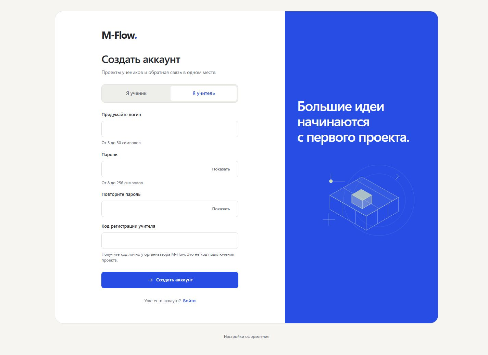
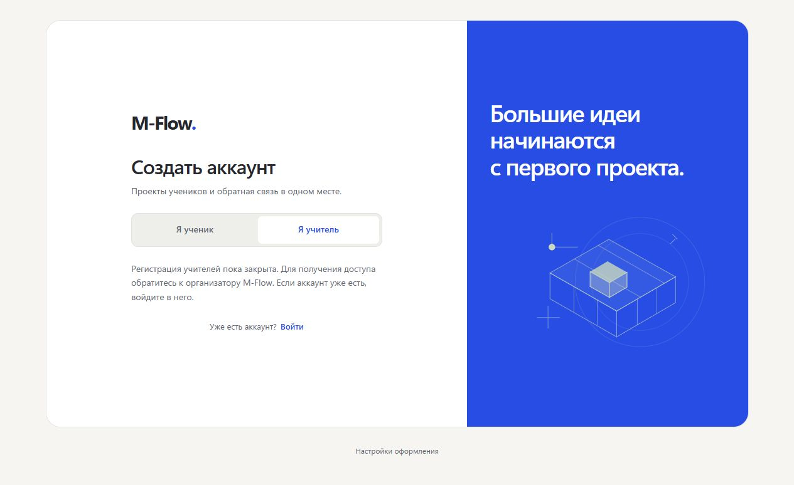

# Регистрация учителей по коду

31.10.2026. Снимки локального приложения на временной SQLite с вымышленными
пользователями. Не production. Код не возвращается в поле после ошибки.

Проверены закрытая регистрация без настройки, вход прежнего учителя,
ошибка неверного кода, успешная регистрация с тестовым кодом, загрузка
скриптов/стилей с новыми заголовками. Ошибок консоли не обнаружено.
В `browser-checks.json` — четыре измерения формы: 320/1440 px, обе темы,
без горизонтального скролла. Это не проверка физических телефонов.

Полные ограничения и следующий этап: [SECURITY_FOLLOWUP.md](../../SECURITY_FOLLOWUP.md).
