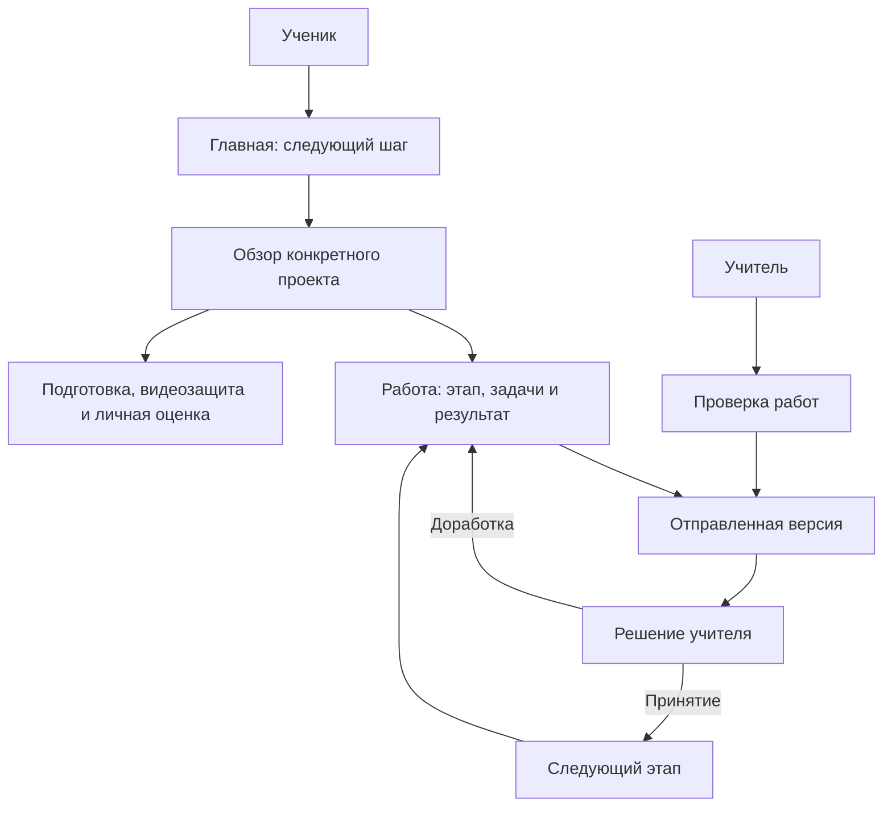

# Схема навигации M-Flow

Статус: согласованная схема внедрена после аудита `17ccc6b`; проверки — в RELEASE.md.

## Три уровня

1. Личное пространство: свои проекты/работы, группы и результаты по роли.
2. Конкретный проект: обзор, работа, команда, завершение.
3. Конкретное действие: задача, результат этапа, версия сдачи или личная оценка.

Название выбранного проекта остаётся видно при переходе между его страницами.
Кнопка действия ведёт к предмету действия, а не просто к верхней части раздела.
Возврат в список ведёт к списку с его условиями, когда их можно безопасно сохранить.

## Публичные страницы и аккаунт

| Группа | Существующие страницы | Назначение |
| --- | --- | --- |
| Вход и регистрация | `/login`, `/teacher/login`, `/register`, `/teacher/register` | Одна композиция, явная роль; код учителя не смешивается с кодом группы |
| Восстановление | `/forgot-password`, `/reset-password` | Запрос письма, новое значение пароля, недействительная/использованная ссылка |
| Подтверждение почты | `/email/confirm` | Подтвердить адрес; возврат в доступную часть аккаунта |
| Профиль | `/profile`, `/profile/email`, `/skills` | Личные данные, доступ, почта, пароль и добровольная видимость навыков |
| Настройки | `/settings` | Оформление и движение; существующее публичное оформление сохраняется |
| Уведомления | `/notifications` и колокольчик | Переход к конкретной работе/согласованию; прочтение не означает принятие работы |
| Помощь и данные | `/data` | Существующие объяснения и помощь; не выдумывать контакты или юридические сведения |

Публичный вход не требует знакомства с внутренней структурой. При ошибке пользователь
остаётся в своём действии и видит способ продолжить. Самостоятельное восстановление
сохраняет действующее условие заранее подтверждённой почты; интерфейс не обходит его.

## Главное меню

| Ученик | Адрес, который сохраняем | Назначение |
| --- | --- | --- |
| Главная | `/` | Текущий проект, один следующий шаг, ближайшие задачи |
| Мои проекты | `/#my-projects` | Все доступные проекты, поиск, создание, участники и приглашения |
| Учебные группы | `/groups` | Мои группы и вступление по коду |
| Мои результаты | `/#student-results` | Сдачи, замечания и свои опубликованные оценки |

| Учитель | Адрес, который сохраняем | Назначение |
| --- | --- | --- |
| Кабинет | `/teacher` | Краткая сводка и ближайшая работа |
| Проверка работ | `/teacher#review-queue` | Сдачи для решения; отчёты задач обозначены отдельно |
| Проекты учеников | `/teacher#teacher-projects` | Проекты, реальные состояния этапов, переход к оцениванию |
| Учебные группы | `/groups` | Группы и конкретные ученики/проекты |

Общие действия: уведомления и текстовое «Мой аккаунт». В аккаунте — имя, роль,
профиль, настройки и POST-выход. Тема остаётся в настройках. Расположение общих
действий не меняется от роли. Отдельный глобальный пункт «Оценивание» у учителя
убран; явная кнопка оценивания сохранена в каждом доступном проекте.

Главная и список проектов решают разные задачи, даже если сервер использует
один маршрут. Их видимый заголовок, название вкладки и указатель положения должны
отражать выбранный раздел. Хеш-адреса и возвраты браузера продолжают работать.

## Внутри проекта

| Раздел | Существующий адрес | Содержание |
| --- | --- | --- |
| Обзор | `/project/{id}` | Следующий шаг, относящееся к нему замечание, руководитель и краткий прогресс |
| Работа над проектом | `/project/{id}/stages` | Пять этапов, задачи, материалы, результат и действия по роли |
| Команда | `/project/{id}/team` | Участники, их роли, приглашения и разрешённые владельцу действия |
| Защита и результат | `/project/{id}/preparation` | Подготовка с переходами к записи и оценке |

В завершении сохраняются три страницы: **Подготовка**, **Видеозащита** (`/defense`),
**Оценивание** (`/assessment`). Это продолжения адреса проекта. Они доступны на
любом этапе; принятие пятого этапа не является условием открытия страниц.

**История работ и решений** (`/project/{id}/history`) остаётся доступна из каждого
раздела рядом с названием проекта. У результата этапа сохраняется ссылка на
историю именно этой работы, включая параметр `work=stage-{n}`.

На телефоне основные разделы проекта занимают компактные два ряда.
История не создаёт третий ряд вкладок. Все пять этапов и предыдущие результаты
остаются доступны; компактность не должна скрывать состояние текущего этапа.

## Место функций, которые уходят из главного меню

| Функция | Где пользователь её находит | Адрес/ограничение |
| --- | --- | --- |
| Найти участников по навыкам | «Мои проекты» и «Команда» конкретного проекта | `/teams#people`; это каталог участников, не каталог открытых проектов |
| Полученные приглашения в команды | Видимый переход из «Моих проектов», включая пустой список | `/teams#team-invitations`; существующий блок, включая пустое состояние |
| Мои навыки и видимость в каталоге | Профиль и каталог участников | `/skills`; показ по-прежнему добровольный |
| Оценить ученика | Карточка проекта учителя, завершение проекта, строка ученика группы | `/project/{id}/assessment`, существующий выбор ученика сохраняется |
| Подключить или сменить руководителя | Блок «Руководитель проекта» в обзоре; предложения из группы | `/supervision?project={id}`; контекст доступного проекта, прежние согласия |
| Создать приглашение учителя | Кабинет учителя и раздел руководителя | `/supervision`; код и двухстороннее согласование сохраняются |
| Выйти из группы / архивировать группу | Служебный блок конкретной группы | `/groups/{id}`, существующие POST-формы |
| Смена пароля и подтверждение почты | Профиль → доступ и безопасность | `/profile`, `/profile/email`; восстановление `/forgot-password` и `/reset-password` |

Именованные якоря приглашений и каталога добавлены. Новый переход виден в пустом
списке проектов и после вступления в команду; принятие приглашения проверено в браузере.
Старый адрес `/teams` сохранён.

## Правила следующего шага

| Реальное состояние | Что видит ученик | Что видит учитель |
| --- | --- | --- |
| Нет проекта | Код группы / создание проекта; второстепенно — участники и приглашения | Понятное приглашение ученика и создание группы |
| Нет руководителя | Конкретный проект и способ согласовать руководителя; черновик доступен | Создание приглашения / имеющиеся согласования |
| Черновик | Продолжить или проверить результат перед отправкой | Ожидание сдачи; черновик нельзя принять |
| На проверке | Результат отправлен; редактирование недоступно, задачи доступны | Открыть текущую отправку и сохранить решение |
| Доработка | Замечание к этой работе и прямой переход к редактированию | Ожидание повторной сдачи, предыдущая версия доступна |
| Повторная сдача | Ожидание нового решения; прежнее замечание обозначено как прежнее | Проверить новую отправку; история доступна |
| Этап принят | Принятый результат доступен; следующий этап | Сохранённое решение и состояние следующего этапа |
| Пять этапов приняты | Следующий шаг по реальному состоянию защиты и личной оценки | Защита/оценивание по их собственным состояниям |

Выполнение всех задач не принимает этап. Принятие этапов не принимает защиту.
Принятие защиты не публикует личные оценки. Учебная группа не открывает чужие работы.

## Два маршрута

Диаграмма показывает путь по интерфейсу. Серверные условия допуска, порядка
этапов, ревизий, руководства и публикации оценок определяются существующей логикой.
